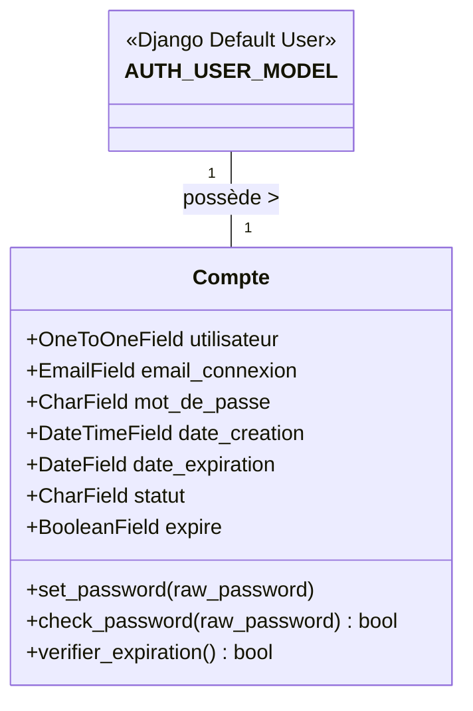
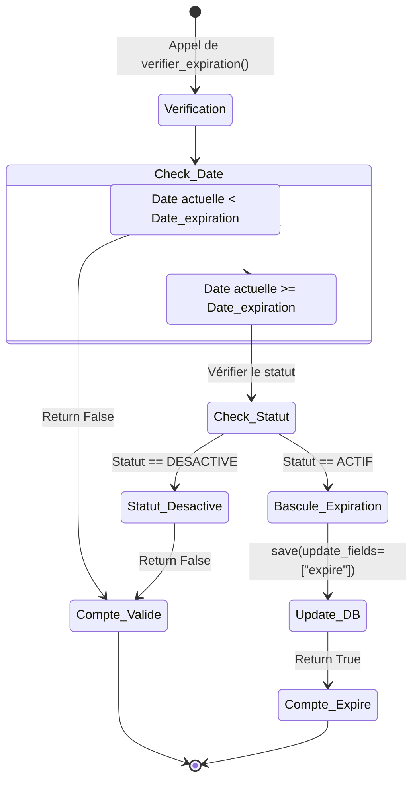
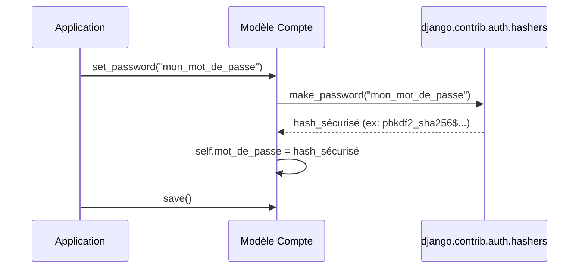

# Diagrammes Techniques - Gestion de Comptes

## Diagramme de Classes

### Description du Diagramme de Classes

Le système s'articule autour de l'entité `Compte`.

**Relations :**
* Le `Compte` étend le modèle utilisateur par défaut de Django (`AUTH_USER_MODEL`) via une relation **OneToOneField**. Si l'utilisateur principal est supprimé, son profil de connexion l'est aussi (via `on_delete=models.CASCADE`).

**Énumérations (Enums) :**
* **Statut (`Compte.Statut`)** : Les choix possibles sont `ACTIF` ou `DESACTIVE`.

---

## Diagrammes d'Activité et de Séquence

### 1. Workflow : Vérification de l'Expiration du Compte (Activité)

### 2. Séquence : Création / Hashage du Mot de Passe

---

## URLs et Vues

> **Note :** À l'heure actuelle, le module `account_management` encapsule la structure de la base de données et la logique métier de sécurité cryptographique au sein du modèle (`models.py`). 
> 
> Les URLs et les Vues Django associées (endpoints web pour l'interface de connexion, d'inscription ou d'administration personnalisée) sont en cours d'intégration et le fichier `urls.py` n'a pas encore de routes exposées. 
