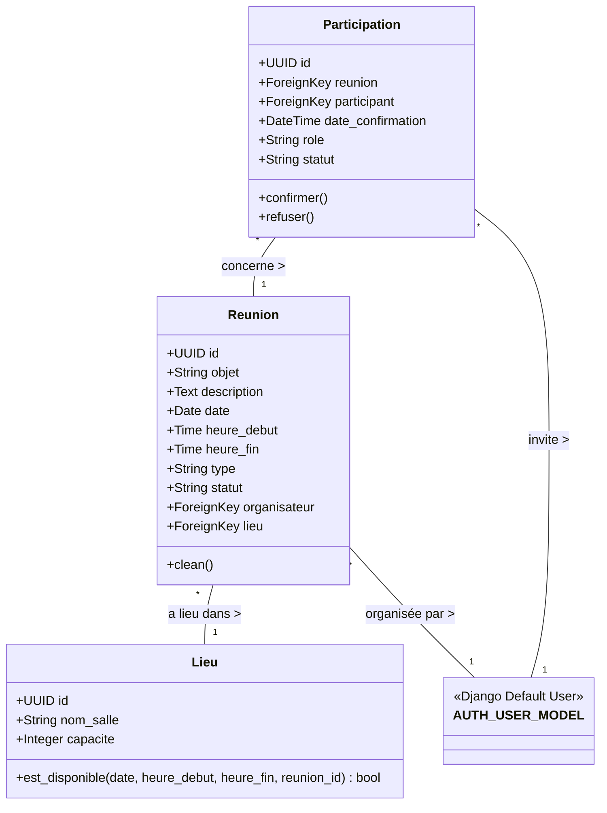
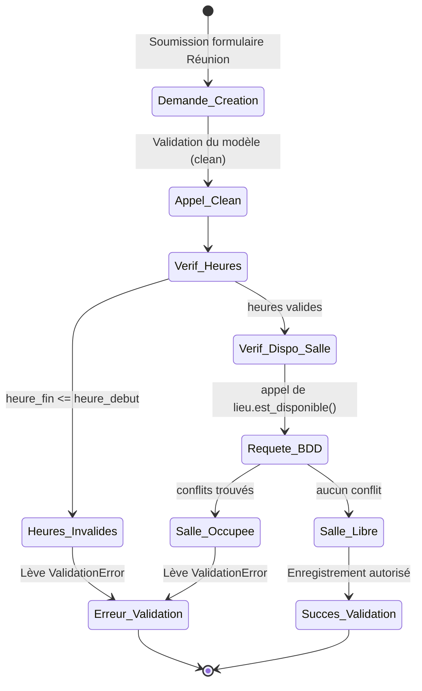
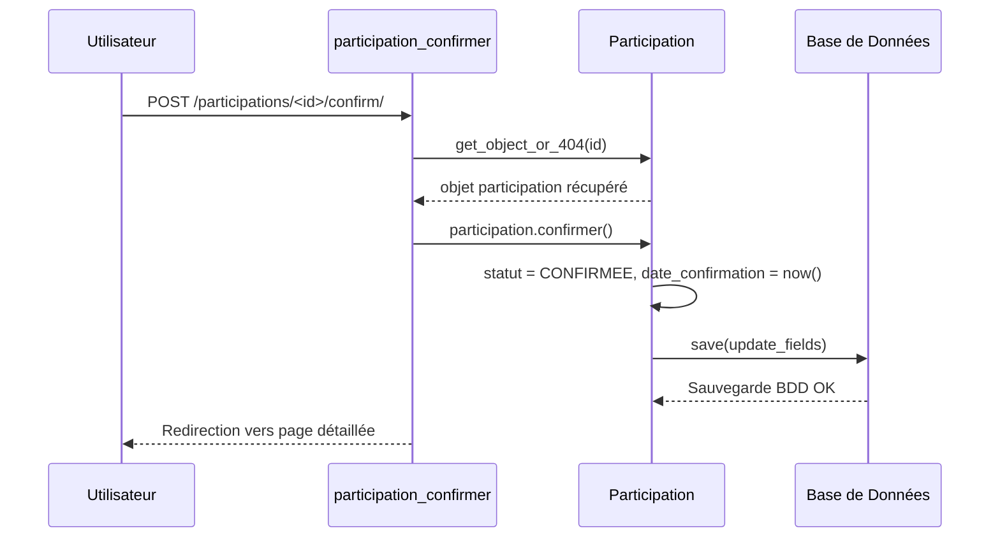

# Diagrammes Techniques - Module Réunions

*(Les diagrammes de classes, d'activité et de séquence utilisent le format Mermaid ci-dessous, mais sont également accompagnés de descriptions textuelles détaillées pour appuyer vos présentations).*

## 1. Diagramme de Classes

### Explication du Diagramme de Classes
* **Clés primaires UUID** : Les trois modèles principaux (`Lieu`, `Reunion`, `Participation`) utilisent des UUID (identifiants uniques universels) au lieu des IDs séquentiels automatiques. C'est une excellente pratique pour sécuriser les URLs, car les IDs ne sont pas devinables.
* **Relations** : 
  * Une `Reunion` est liée obligatoirement à un `Lieu` et un `organisateur` (qui est un utilisateur).
  * La table `Participation` sert de modèle intermédiaire (relation Many-To-Many avec attributs ajoutés) entre une `Reunion` et un `Participant` invité.
* **Énumérations** : Les classes `TypeReunion`, `StatutReunion` et `StatutParticipation` utilisent `models.TextChoices` pour restreindre fortement les valeurs acceptées en base de données, évitant ainsi des erreurs d'étiquetage.

---

## 2. Diagrammes d'Activité et Séquence

### A. Workflow : Vérification de Disponibilité d'une Salle (Activité)

**Explication Textuelle** : 
Ce diagramme montre le processus de validation de sécurité avant qu'une réunion ne soit enregistrée en base. Le framework Django appelle la méthode `clean()`. Celle-ci vérifie la cohérence temporelle (l'heure de fin doit suivre l'heure de début). Ensuite, elle requête la base pour vérifier s'il existe une réunion, pour le même jour, dans la même salle, dont les heures se chevauchent avec la nouvelle. S'il y a intersection (salle occupée), l'enregistrement est immédiatement bloqué avec une erreur (`ValidationError`).

### B. Séquence : Réponse d'un Participant (Confirmation)

**Explication Textuelle** : 
Ce schéma décrit comment le système traite une confirmation d'invitation. L'utilisateur envoie une requête POST (via un bouton) à la vue dédiée. La vue récupère en toute sécurité l'enregistrement de `Participation` depuis la BDD. Elle appelle ensuite la méthode métier `confirmer()` sur le modèle. Ce dernier change le statut, inscrit l'heure actuelle, et enregistre les modifications ciblées en BDD. La vue redirige ensuite l'utilisateur vers la réunion avec un message de succès.

---

## 3. URLs et Endpoints

Le fichier `urls.py` du module compte 15 terminaux web, structurés logiquement :

### Gestion des Lieux
| Action | URL Pattern | Nom (name) |
| :--- | :--- | :--- |
| Liste | `/lieux/` | `lieu_list` |
| Création | `/lieux/create/` | `lieu_create` |
| Détail | `/lieux/<uuid:pk>/` | `lieu_detail` |
| Mise à jour | `/lieux/<uuid:pk>/edit/` | `lieu_update` |
| Suppression | `/lieux/<uuid:pk>/delete/` | `lieu_delete` |

### Gestion des Réunions
| Action | URL Pattern | Nom (name) |
| :--- | :--- | :--- |
| Liste | `/` | `reunion_list` |
| Création | `/create/` | `reunion_create` |
| Détail | `/<uuid:pk>/` | `reunion_detail` |
| Mise à jour | `/<uuid:pk>/edit/` | `reunion_update` |
| Suppression | `/<uuid:pk>/delete/` | `reunion_delete` |

### Gestion des Participations
| Action | URL Pattern | Nom (name) |
| :--- | :--- | :--- |
| Ajouter participant | `/<uuid:reunion_pk>/participants/create/` | `participation_create` |
| Supprimer participant | `/participations/<uuid:pk>/delete/` | `participation_delete` |
| Confirmer présence | `/participations/<uuid:pk>/confirm/` | `participation_confirmer` |
| Refuser présence | `/participations/<uuid:pk>/refuse/` | `participation_refuser` |
